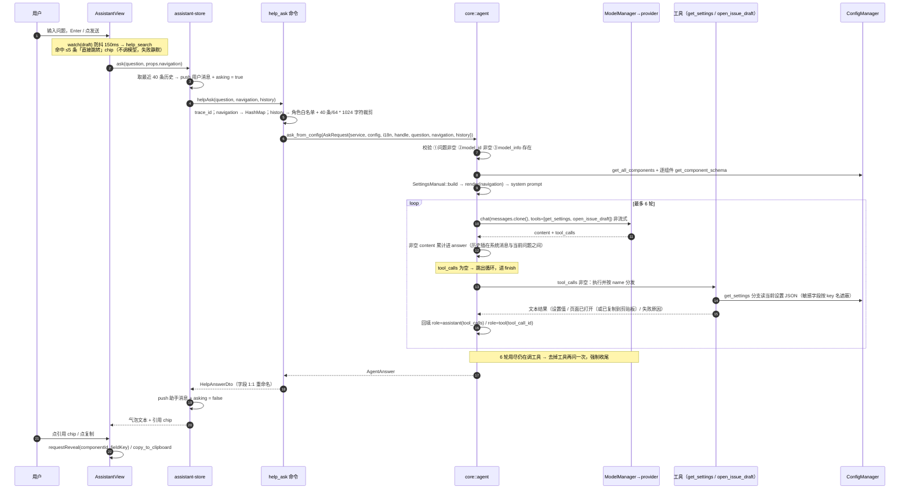
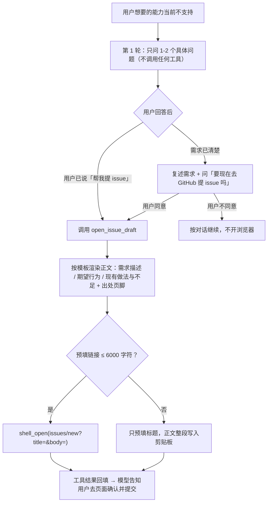
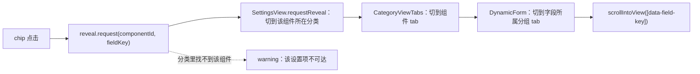

# 「问 AI」完整流程 + 精简审查（as-built）

范围：设置窗侧边栏末位「问 AI」页，从用户发出问题到答复渲染的整条链路，含前置的「输入即检索」快路径，
以及「不支持的能力 → 多轮澄清 → 提 issue 草稿」这条支路。
两条 IPC：`help_ask`（模型 + 两个工具：读设置 `get_settings`、开预填 issue 草稿 `open_issue_draft`）、
`help_search`（确定性检索，不调模型）。

## 1. 参与方

| 层 | 文件 | 职责 |
|---|---|---|
| 前端页面 | `src-ui/views/settings/AssistantView.vue` | 输入 / 发送 / 气泡 / 引用 chip / 复制；输入防抖检索 |
| 前端状态 | `src-ui/stores/assistant-store.ts` | 对话消息 + `asking`（跨页切换保留） |
| 前端路径 | `src-ui/views/SettingsView.vue:119-141` | 装配 `navigation`（分类 › 组件，按当前语言拼好） |
| IPC | `src-tauri/src/commands/help.rs` | trace_id、入参整形、历史角色白名单与裁剪、错误码映射、DTO |
| agent | `src-tauri/src/core/agent/{mod,manual,tools,prompt,settings}.rs` | 说明书、工具循环（读设置 / 提 issue 草稿）、提示词格式契约、引用解析 |
| 模型层 | `src-tauri/src/core/model/{mod,ollama_provider,openai_compatible_provider}.rs` | 路由 + 能力闸门 + 线格式 |
| 配置 | `src-tauri/src/core/config/manager.rs` | schema 快照与设置取值（工具的数据源） |

## 2. 端到端时序

## 3. 关键判定与闸门

| 位置 | 判定 | 结果 |
|---|---|---|
| `AssistantView.vue:161` | `canSend`：非空且非 asking | 按钮禁用（展示层前置门） |
| `core/agent/mod.rs:112-140` | 问题空 / `model_id` 空 / 模型不在 `model_info` | `AgentError::QuestionEmpty`、`ModelNotConfigured`、`ModelUnknown` |
| `commands/bridge_error.rs:223` | 上三类 → `VALIDATION_FAILED`；`ProviderUnavailable`/`Transport` → `NETWORK_ERROR` | 前端 toast / 气泡错误文案 |
| `ollama_provider.rs:165-174`、`openai_compatible_provider.rs:94-101` | 请求带 `tools` 且该模型在配置里有条目但未勾 `tools` 能力 | `InvalidRequest("模型未声明支持 tools 能力")`；**未声明的模型无条目 → 跳过闸门** |
| `core/agent/mod.rs:215-247` | 循环退出条件（`MAX_ROUNDS = 6`，`:35`） | 无 `tool_calls` → `finish`；带 `tool_calls` 那一轮的正文同样累计进答复（否则答复缺前半段）；6 轮用尽去工具再问一次强制收尾 |
| `commands/help.rs:169-191`（`bound_history`） | 前端下发的历史：角色只认 `user`/`assistant`，最近 40 条（20 轮）、总长 ≤64 * 1024 字符 | 角色非法或内容为空的消息丢弃；超预算的更旧消息整条丢弃 |
| `core/agent/tools/get_settings.rs`（`mask_sensitive`） | 敏感字段 key（`SchemaBuilder::sensitive`，如 `api_key`） | 递归遮蔽为 `[该字段为敏感值，已隐藏]`，只影响工具结果，说明书仍描述该字段 |
| `core/agent/tools/open_issue.rs`（`OpenIssueTool`） | 已打开过页面 / 缺必填参数 / 链接超 `MAX_URL_LEN` | 重复调用只回文本；缺参回文本让模型自纠；超长退化为「标题预填 + 正文进剪贴板」 |
| `core/agent/mod.rs`（`run_tool`） | 工具名未知 / 参数非法 | 同样以文本回喂模型，不中断循环 |
| `core/agent/mod.rs:303`（`split_references`） | 行首 `相关设置` + 冒号；token 形如 `<组件id>/<字段key>` | 剔除该行；臆造项丢弃；去重；上限 6；补组件名与字段标签 |
| `commands/help.rs:147-157` | 输入即检索（快路径） | 命中直接跳设置项，不调模型；失败静默只留提问路径 |

## 3.1 提 issue 支路（澄清 → 确认 → 预填草稿）

工具契约与外部约束（`core/agent/tools/open_issue.rs` + GitHub 侧事实）：

| 项 | 值 / 依据 |
|---|---|
| 工具名与入参 | `open_issue_draft{title, summary, expected, current_workaround?}`；模板结构由工具渲染，模型只填字段 |
| 目标链接 | `<repository>/issues/new?title=…&body=…`；仓库地址唯一权威 = workspace `Cargo.toml:19`，经 `env!("CARGO_PKG_REPOSITORY")` 编译期注入（`src-tauri/Cargo.toml` 用 `repository.workspace = true` 继承） |
| GitHub 支持的 query 参数 | `title` / `body` / `labels` / `milestone` / `assignees` / `projects` / `template`（GitHub Docs《Creating an issue》「Creating an issue from a URL query」） |
| 为何不带 `labels` | 无标签权限的用户会整页 404（同文档：no permission → 404） |
| 长度上限 `MAX_URL_LEN = 6000` | 实测（2026-10，未登录直连 github.com）：URL ≈4.6k 时 302→登录页且 `return_to` 保留完整 query，≈6.9k 起 `return_to` 被丢弃，≥≈8.2k 直接 414 URI Too Long |
| 中文膨胀 9× | 1 个汉字 = 3 字节 UTF-8 = 9 个 `%XX`，故 6000 字符 ≈ 600 汉字正文；超出走剪贴板兜底 |
| 单次调用守卫 | 工具实例每次提问新建，`opened: AtomicBool` 记录已打开，重复调用只回文本（不连开标签页） |
| 副作用出口 | `PluginHandle::shell_open(OpenTarget::Url)` 与 `set_clipboard_text`；本模块不直接碰平台 API |
| 用户侧兜底 | 打开的是草稿页，提交动作始终由用户在浏览器完成；工具结果文本会告知用户「去页面确认并提交」或「先粘贴剪贴板正文」 |

## 4. 跳转链路（引用 chip 与检索命中 chip 共用）

跳转时 `CategoryViewTabs` / `DynamicForm` 都是**刚挂载**的，`watch` 看不到已发生的 target 变更，故三方各有 `onMounted` 兜底（已修的陷阱）。

## 5. 可精简点（按收益排序）

### ① `run_ask` + 两个 DTO 是纯重命名隧道 —— 删

- 证据：`AgentAnswer { answer, references }` / `AgentReference { component_id, component_name, field_key, field_label }`（`core/agent/mod.rs:37-58`）与 `HelpAnswerDto` / `HelpReferenceDto`（`commands/help.rs:34-51`）字段一一对应；`run_ask`（`commands/help.rs:196-212`）只搬字段，丢 0 个字段、做 0 个决定、加 0 道边界。
- 判定：同一进程、同一 crate，不过进程 / 序列化边界 → 命中「只把上游字段抄进自己的 DTO 再转交下游 = 隧道层」。
- 方案：给两个 agent 类型加 `#[derive(Serialize)]` + **字段级** `#[serde(rename = "componentId")]` 等（规则 `serde-rename` 禁止 `rename_all`），`help_ask` 直接返回 `AgentAnswer`；删 `run_ask`、`HelpAnswerDto`、`HelpReferenceDto`。前端契约（`bridge/contract.ts:443-466`）不变。
- 保留：`From<AgentError> for BridgeError` 与 trace_id —— 那是买「错误码归类」的边界，不属于这条隧道。
- 检索侧不同：`ManualHit → HelpHitDto`（`help.rs:147-157`）丢掉内部排序键 `score`，属真投影，保留映射。

### ② 说明书每次请求重建（结构性重复计算）

- 证据：每次提问都 `SettingsManual::build`（`core/agent/mod.rs:190`）；每个防抖键入也全量 build（`commands/help.rs:148`）。build 内逐组件走 `get_component_schema`（`manager.rs:169-188`）→ `settings_contribution()`（`crates/plugin-api/src/config/configurable.rs:50-53`）**每次重新编译并校验 schema**，再逐字段过 `I18nManager`。
- 量级 `[INFERENCE]`：树上 `impl Configurable for` 57 处（含测试替身），实际注册数按启动注册表计；单次成本 = 组件数 × 字段数，**未实测**。要测就在 `core/agent` 里加一个 `#[ignore]` 测试，用 `Instant` 计时并以断言消息暴露（仓库 `no-println` 规则禁止 `println!`）。
- 方案（仅当实测可观）：缓存 `SettingsManual`，失效点两个且都由既有事件驱动 —— ① `ConfigEvent::{Registered, Unregistered}`（插件加载 / 崩溃卸载 / 组件注册）② `I18nManager::set_language`（语言切换）。漏失效 ② 会让导航文案停在旧语言，这是新增的第二权威，收益不明确就不做。
- 现状优点：无跨请求状态，正确性最简单。

### ③ 前端对后端「已翻译文本」再猜一次（key-or-literal 歧义）

- 证据：后端 `I18nManager::t` 已按当前语言解析、未命中才回退 key 原文（`core/i18n/mod.rs:68-88`），说明书与引用里的 `componentName` / `fieldLabel` / `label` 都是解析后的值；前端仍 `resolveText()`（`AssistantView.vue:85,165-166`，实现 `i18n/index.ts:31-33` = `te(s) ? t(s) : s`）。
- 问题：上游没区分「最终文本」与「i18n key」，下游只能猜 → 有损表示 + 下游猜测翻译。
- 方案：把契约写明（助手路径下发的标签一律是最终文本）后，删掉助手路径的 `resolveText`；`SettingsView.vue:129,138` 的两处**不能删**（那里读的是 `config_get_all_components` 的原始 `component_name`，可能还是 key）。缺译文属后端 bug，不该让下游兜底。
- 风险：低；改后真机点几个引用 chip 确认文案即可。

### ④ 循环内每轮全量克隆消息 + 重建工具声明

- 证据：`core/agent/mod.rs:215-216` 每轮 `messages.clone()`（含整段说明书）与 `tool_specs(&tools)`（重新分配 name / description / parameters）。
- 方案：`tool_specs` 提到循环外（几行改动）。消息克隆受 `ModelService::chat(ModelChatRequest)` 取 owned 值所限，要省就得把 trait 改成按引用传参（影响 ai-search 调用方）→ 跨 crate 契约变更，**不值得**。
- 判定：低优先，最多做 `tool_specs` 外提。

### ⑤ ~~`AgentTool` trait + 动态分发只服务一个工具~~（判断已作废）

- 2026-10 新增第二个工具 `open_issue_draft`：工具集 = `get_settings` + `open_issue_draft`（`core/agent/mod.rs:191-204`），`run_tool` 的按 name 分发与「未知工具回文本」都是活代码。
- 判定：**保留**，不再是精简候选。此条保留只为记录判断为何反转（原判断的前提「工具集恒为 1 个」已不成立）。

### ⑥ 前端 `modelReady` 镜像后端判定（保留，必须同步）

- 证据：`AssistantView.vue:156-159` 复制了「`model_id` 为空 = 未配置」；权威在 `AgentError::ModelNotConfigured`（`core/agent/mod.rs:97-106`）。另有 `onMounted` 单独拉一次助手配置（`:240-246`）修「未访问过配置页就误报未配置」。
- 判定：保留（提示要在提问**之前**出现，必须读配置）。属镜像点，注释已声明，后端判定变更时必须同步。

### ⑦ 刻意保留、不要动的设计

- `navigation` 由前端下发：分类结构是前端所有物，后端硬编码 = 第二权威。
- 两入口（`help_search` / `help_ask`）共用同一份 `SettingsManual` = 单一权威，禁止给 AI 另写一份说明。
- 非流式：工具调用需要完整载荷，无 tool_call 分片重组。
- 问题非空校验在前端（`canSend`）与后端（`QuestionEmpty`）各一次：入口边界兜底，属允许。
- 细枝：`help_search` 返 20 条、前端取 5 条，可顺带加 limit 参数（非必要）。
